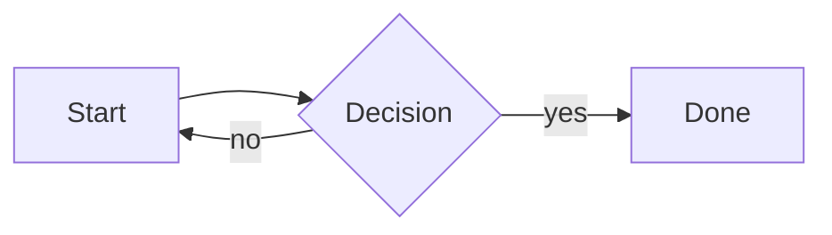

# Mermaid Diagrams for MarkdownRenderX.Avalonia

[English](README.md) | [简体中文](README.zh-CN.md)

Renders ` ```mermaid ` fenced code blocks as native SVG diagrams inside
[`MarkdownRenderX.Avalonia`](https://www.nuget.org/packages/MarkdownRenderX.Avalonia).
No WebView, no browser, no JavaScript runtime — everything is pure .NET.

```xml
<PackageReference Include="MarkdownRenderX.Avalonia.Mermaid" Version="12.1.3.7" />
```

## Usage

Register once at application startup:

```csharp
using MarkdownRenderX.Avalonia.Mermaid;

MermaidExtension.Register();
```

That is all — no `StyleInclude`, no resource dictionary, no extra initialization.
Because `FluentAvalonia.MarkdownRender` is a companion package built on the same
core, **the same single registration also enables Mermaid in FAMR**.

````markdown

````

## Supported diagrams

Layout and parsing are provided by [Mermaider](https://github.com/nullean/mermaider),
which supports flowcharts, sequence diagrams, class diagrams, state diagrams,
ER diagrams, Gantt charts, pie charts, mind maps, timelines, Kanban boards and
more. Refer to its documentation for the exact syntax coverage.

This is a native re-implementation, not the Mermaid.js runtime: advanced Mermaid.js
features (custom themes, `%%{init}%%` directives, click handlers, plugins) are not
available. Unsupported input falls back to the built-in syntax-highlighted code
block instead of breaking the document.

## Themes

```csharp
MermaidExtension.Instance.Theme = MermaidTheme.Dark;   // Auto (default) | Light | Dark
MermaidExtension.Instance.MaxHeight = 400;             // 0 = unlimited
```

`Auto` samples the application's current theme when a diagram is rendered, and
picks a light or dark palette. Because the output is a static SVG image, changing
the application theme at runtime does not recolour diagrams already on screen;
render them again (or set the theme explicitly) to pick up the change.

## How it works

1. The core package's `IMarkdownNodeRenderer` extension point intercepts a
   `FencedCodeBlock` whose info string is `mermaid`.
2. `MermaidRenderer.RenderSvg` parses and lays out the diagram, producing an SVG.
3. Mermaider's SVG relies on CSS custom properties (`var(--fg)`), `color-mix()`
   and `rem` units, none of which Svg.Skia understands. `SvgCssFlattener` expands
   those expressions into literal hex colours and removes the unsupported
   `<style>` block.
4. `SvgSource.LoadFromStream` + `SvgImage` draws the result through SkiaSharp.

If parsing fails, the renderer returns `null`, so the core falls back to showing
the original fenced code block. The reason is available at
`MermaidExtension.Instance.LastError` for diagnostics.

## Third-party notices

See [THIRD_PARTY_NOTICES.md](THIRD_PARTY_NOTICES.md). Mermaider and Sugiyama are
MIT-licensed; this package embeds no fonts and no image assets.

Source comments are in Chinese; contributions in English are welcome.
