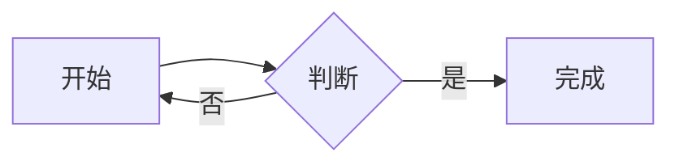

# MarkdownRenderX.Avalonia.Mermaid

[English](README.md) | [简体中文](README.zh-CN.md)

把 ` ```mermaid ` 围栏代码块渲染成原生 SVG 图表，用于
[`MarkdownRenderX.Avalonia`](https://www.nuget.org/packages/MarkdownRenderX.Avalonia)。
**不使用 WebView、浏览器或 JavaScript 运行时**，全链路纯 .NET。

```xml
<PackageReference Include="MarkdownRenderX.Avalonia.Mermaid" Version="12.1.3.7" />
```

## 用法

在应用启动时注册一次：

```csharp
using MarkdownRenderX.Avalonia.Mermaid;

MermaidExtension.Register();
```

不需要 `StyleInclude`，也不需要额外样式文件。因为 `FluentAvalonia.MarkdownRender`
是构建在同一核心包上的副包，**注册一次对 FAMR 同样生效**。

````markdown

````

## 支持的图表

解析与布局由 [Mermaider](https://github.com/nullean/mermaider) 提供，支持流程图、
时序图、类图、状态图、ER 图、甘特图、饼图、思维导图、时间线、看板等。
具体语法覆盖范围以它的文档为准。

这是原生实现，**不是 Mermaid.js 运行时**：自定义主题、`%%{init}%%` 指令、
点击事件、插件等高级特性不支持。无法解析的内容会回退为内置的语法高亮代码块，
不会破坏整篇文档。

## 主题

```csharp
MermaidExtension.Instance.Theme = MermaidTheme.Dark;   // Auto（默认）| Light | Dark
MermaidExtension.Instance.MaxHeight = 400;             // 0 = 不限制
```

`Auto` 在渲染时读取应用当前主题并选择浅色 / 深色配色。由于输出是静态 SVG 图片，
运行时切换主题不会重新着色已显示的图表，需要重新渲染（或显式指定主题）。

## 实现原理

1. 核心包的 `IMarkdownNodeRenderer` 扩展点拦截 info 为 `mermaid` 的 `FencedCodeBlock`。
2. `MermaidRenderer.RenderSvg` 解析并布局，输出 SVG。
3. Mermaider 的 SVG 大量使用 CSS 变量（`var(--fg)`）、`color-mix()` 与 `rem` 单位，
   Svg.Skia 均不支持。`SvgCssFlattener` 把这些表达式展开成字面的十六进制颜色，
   并移除不支持的 `<style>` 块。
4. `SvgSource.LoadFromStream` + `SvgImage` 通过 SkiaSharp 绘制。

解析失败时渲染器返回 `null`，核心包回退显示原始代码块；失败原因可从
`MermaidExtension.Instance.LastError` 读取。

## 第三方声明

见 [THIRD_PARTY_NOTICES.md](THIRD_PARTY_NOTICES.md)。Mermaider 与 Sugiyama 均为
MIT 许可；本包不内嵌字体与图片资源。
